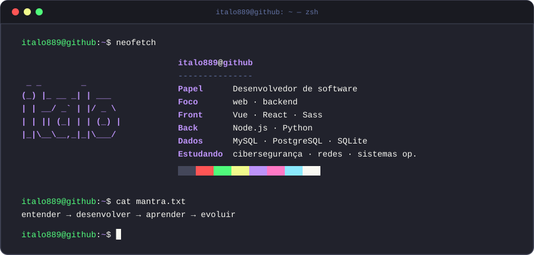
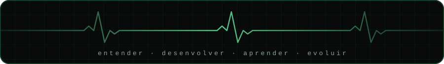

<!-- Se você está lendo o código-fonte deste README, já é meio caminho andado. Há um desafio escondido mais abaixo. -->

<div align="center">



<br />

<a href="https://github.com/italo889?tab=repositories"></a>


</div>

<br />

## `~/sobre`

<div align="center">
  
</div>

<br />

Gosto de entender **como as coisas funcionam por trás da interface**: aplicações, sistemas e as decisões que os mantêm de pé. Desenvolvo software e estudo **segurança cibernética** de forma gradual, sem pular a base de engenharia.

> Cada projeto é uma chance de aprender, experimentar e evoluir.

<br />

## `~/package.json`

```json
{
  "name": "italo889",
  "version": "∞.0.0",
  "description": "desenvolvedor de software · aprendiz de segurança",
  "scripts": {
    "dev": "entender && construir && aprender",
    "estudar": "ciberseguranca --redes --sistemas-operacionais",
    "build": "projeto --com-curiosidade"
  },
  "dependencies": {
    "vue": "*",
    "react": "*",
    "sass": "*",
    "node": "*",
    "python": "*",
    "mysql": "*",
    "postgresql": "*",
    "sqlite": "*"
  },
  "devDependencies": {
    "curiosidade": "latest",
    "persistencia": "latest"
  }
}
```

<div align="center">


</div>

<br />

## `~/desafio-escondido`

<details>
<summary><b>🔐 Para quem curte segurança: decifre a mensagem</b> (clique para abrir)</summary>

<br />

Encontrei isto escrito num bilhete e não consegui ler:

```text
ZmxhZ3tjdXJpb3NpZGFkZV9lX29fcHJpbWVpcm9fZXhwbG9pdH0=
```

**Dica:** isso não é criptografia, é só um jeito de transportar bytes como texto. Costuma terminar em `=`, e o terminal do seu Linux já sabe lidar com isso.

Se decifrou, abra uma *issue* neste repositório e me conte o que encontrou. 🙂

</details>

<br />

## `~/estatisticas`

<div align="center">


<br /><br />


<br /><br />



</div>
